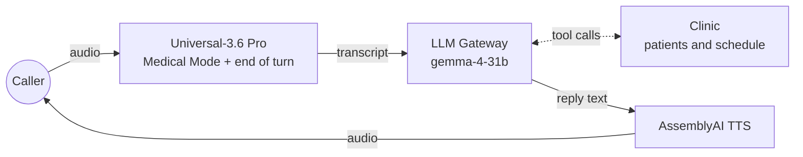

# AssemblyAI medical receptionist voice agent for LiveKit

A starter voice agent built with [LiveKit Agents](https://github.com/livekit/agents), where every model is from AssemblyAI and runs on one API key. Ava answers the phone for a made-up clinic, Riverside Family Medicine. She takes a new patient's intake details or looks up a returning patient, finds an open time and books the appointment.

| | AssemblyAI service | What it does for Ava |
|---|---|---|
| **Ears** | [Universal-3.6 Pro streaming speech-to-text](https://www.assemblyai.com/docs/voice-agents/livekit-universal-3-6-pro), with [Medical Mode](https://www.assemblyai.com/docs/streaming/medical-mode) | Transcribes the caller, including drug names, doses and member IDs, and decides when they've finished their turn |
| **Brain** | [LLM Gateway](https://www.assemblyai.com/docs/llm-gateway/quickstart) | Runs the conversation and calls the clinic's tools, with your choice of model from Google, OpenAI, Anthropic and others |
| **Voice** | [Streaming text-to-speech](https://www.assemblyai.com/docs/tts/getting-started/quickstart) | Speaks the replies, with word timings so interruptions are recorded accurately |



It's a small, complete starting point: one agent, four tools, a made-up clinic to run them against, tests, and a Dockerfile for deploying to [LiveKit Cloud](https://cloud.livekit.io). Fork it and make it yours.

> [!NOTE]
> The AssemblyAI TTS plugin for LiveKit is in a pull request that hasn't been released yet, [livekit/agents#8040](https://github.com/livekit/agents/pull/8040). Until it is, `pyproject.toml` installs LiveKit Agents and its plugins from [the branch that adds it](https://github.com/dlange-aai/agents/tree/feat/assemblyai-tts). Once it's on PyPI, delete the `[tool.uv.sources]` table and run `uv lock`.

> [!IMPORTANT]
> This is a demo with made-up patients and a made-up schedule. Before a real patient's health information goes through it, you need a Business Associate Agreement (BAA) with every service that processes it, a HIPAA-compliant setup for storage and logs, and a real practice management or EHR system behind the tools. Ava is a receptionist: she doesn't give medical advice, and she sends callers who describe an emergency to 911.

## Quickstart

You need [uv](https://docs.astral.sh/uv/getting-started/installation/), [Git LFS](https://git-lfs.com) (for the voice activity model while the plugin is installed from GitHub), and an [AssemblyAI API key](https://www.assemblyai.com/dashboard/api-keys).

```console
git clone https://github.com/AssemblyAI-Solutions/assemblyai-livekit-reference-voice-agent.git
cd assemblyai-livekit-reference-voice-agent
uv sync
cp .env.example .env.local
```

Put your AssemblyAI API key in `.env.local`, then call Ava from your terminal:

```console
uv run src/agent.py console
```

Console mode uses your computer's microphone and speakers, and needs only the AssemblyAI key. Add `--text` to type instead of talk. Use headphones, so Ava doesn't hear herself. (With [LiveKit CLI](https://docs.livekit.io/intro/basics/cli/) 2.18.8 or later, `lk agent console` does the same.)

### Things to try

- **Be a new patient.** Give your name (Ava asks you to spell your last name), date of birth, phone number, insurance carrier and member ID, medications and allergies, then book a new patient visit. She reads numbers back one character at a time, so you can catch mistakes.
- **Be a returning patient.** Say you're Maria Garcia, born March 14, 1985, and book a follow-up with Dr. Nakamura.
- **See a cardiologist.** Ask for a cardiology consultation with Dr. Okafor, who sees patients on Tuesday and Thursday afternoons.
- **Ask for things she shouldn't do.** Ask whether to change a medication dose, or describe chest pain.

The clinic starts over with every call, and its schedule covers the next two weeks.

## Run it with LiveKit Cloud

To call Ava from a browser or a phone, connect her to LiveKit. Create a free [LiveKit Cloud](https://cloud.livekit.io) project and add its URL and keys to `.env.local`. If you have the [LiveKit CLI](https://docs.livekit.io/intro/basics/cli/), it can write them for you:

```console
lk cloud auth
lk app env --write --destination .env.local
```

Then start the agent in development mode:

```console
uv run src/agent.py dev
```

Open your project's [Agent Console](https://docs.livekit.io/testing/agent-console/) in LiveKit Cloud to talk to her, or connect a frontend such as [agent-starter-react](https://github.com/livekit-examples/agent-starter-react) (web), [agent-starter-swift](https://github.com/livekit-examples/agent-starter-swift) (iOS and macOS) or [agent-starter-android](https://github.com/livekit-examples/agent-starter-android). To give her a phone number, see [LiveKit telephony](https://docs.livekit.io/telephony/).

With LiveKit credentials set, the agent also gets LiveKit Cloud's [adaptive interruption handling](https://docs.livekit.io/agents/logic/turns/adaptive-interruption-handling/), which tells a real interruption from an "uh-huh" in the background. Without them, it logs a warning and falls back to interrupting on voice activity.

## How it works

The agent is in [`src/agent.py`](src/agent.py) and the made-up clinic is in [`src/clinic.py`](src/clinic.py). Both are short enough to read top to bottom. These are the choices they make, and why.

### Speech-to-text

**Medical Mode, a description of the call, and the names it will hear.** `domain="medical-v1"` turns on [Medical Mode](https://www.assemblyai.com/docs/streaming/medical-mode), which improves accuracy on medications, conditions and dosages. It's a paid add-on; remove it to compare. `prompt` describes what a call to the clinic is about, and `keyterms_prompt` lists the clinic's and doctors' names so they're always spelled right.

**Universal-3.6 Pro decides when the caller is done.** `turn_detection="stt"` uses AssemblyAI's end-of-turn detection, which reads the transcript as well as the silence. If a caller pauses partway through a phone number, the model sees an unfinished number and keeps the turn open. `mode="balanced"` waits up to 1.28 seconds of silence before ending a turn regardless, which gives callers room to read out IDs; `"min_latency"` would cut that to 0.64 seconds. `endpointing={"min_delay": 0}` stops LiveKit from adding its own wait on top.

**The STT knows what Ava just asked.** The plugin passes each of Ava's replies to Universal-3.6 Pro as context, so after "What's your date of birth?" the model expects a date. That's on by default and needs no code.

**Silero and AssemblyAI agree on what speech is.** Silero's voice activity detection decides when the caller is interrupting Ava. Its threshold is set to the STT's own (`0.2`), so the two don't disagree about quiet speech.

### The conversation

**The instructions are the receptionist's playbook.** `INSTRUCTIONS` covers how to talk on the phone, the safety rules, the order of the intake questions and how to book. Ava reads back phone numbers, member IDs and confirmation numbers one character at a time, in groups ("4 1 5, 5 5 5, 0 1 9 9"), so the caller can check them.

**The tools change the clinic's records, not the conversation.** `find_patient`, `register_patient`, `check_availability` and `book_appointment` are methods on `Receptionist` decorated with `@function_tool`. Their docstrings and type hints are what the LLM sees. `visit_type` is a `Literal`, so the model can only pass a visit type the clinic offers. The patient a call is about is kept in the session's `CallState`, not passed around by the LLM, so it can't book an appointment for the wrong person. A `ToolError` tells the model what went wrong, such as an unknown patient or a slot that's gone, so it can recover with the caller.

**The LLM Gateway is used through the OpenAI plugin.** The Gateway speaks the OpenAI Chat Completions API, so `openai.LLM(base_url="https://llm-gateway.assemblyai.com/v1", api_key=ASSEMBLYAI_API_KEY)` is all it takes, with streaming and tool calls for every model family.

**Ava can hang up.** LiveKit's `EndCallTool` lets her end the call after saying goodbye.

### Text-to-speech

**The greeting doesn't wait for the LLM.** `session.say()` speaks a fixed greeting as soon as the caller joins, on a TTS connection that `tts.prewarm()` opened in advance.

**Interruptions are recorded word by word.** With `use_tts_aligned_transcript=True`, AssemblyAI TTS's word timings mean that when the caller cuts Ava off, the chat history keeps only the words they actually heard, so the LLM doesn't think it said things it didn't.

## Make it yours

### Your own clinic, or another use case

To connect a real practice, reimplement the methods of `Clinic` in [`src/clinic.py`](src/clinic.py) against your practice management or EHR system's API. Ava only calls `find_patient`, `register_patient`, `upcoming_appointments`, `open_slots` and `book`. Change `CLINIC_NAME` and `PROVIDERS` to your own. If your staff names change, the STT's `keyterms_prompt` picks them up automatically.

For a different kind of agent, replace `clinic.py`, the tools on `Receptionist`, `INSTRUCTIONS` and `GREETING`, and the STT's `domain`, `prompt` and `keyterms_prompt`. The pipeline in `entrypoint` stays the same. See [LiveKit's tool docs](https://docs.livekit.io/agents/logic/tools/) for more on tools, and [workflows](https://docs.livekit.io/agents/logic/workflows/) for splitting a long conversation into separate agents.

### LLM

Set `LLM_MODEL` to any model on the [LLM Gateway](https://www.assemblyai.com/docs/llm-gateway/available-models) (`GET https://llm-gateway.assemblyai.com/v1/models` lists them). For a voice agent, time to the first token matters most, because Ava can't start speaking until the LLM does. Here's how a few models compared in one test, streaming a reply with a tool attached, measured from the US East Coast in October 2026:

| Model | Median time to first token |
|---|---|
| `gemma-4-31b` (default) | ~0.6 s |
| `gemini-3.5-flash-lite` | ~0.7 s |
| `claude-haiku-4-5-20251001` | ~0.8 s |
| `gpt-4.1` | ~0.8 s |
| `claude-haiku-5-5` | ~1.0 s |
| `gemini-3.6-flash` | ~2.2 s |

Gemma 4 31B passes this repo's tests, including full intake and booking calls. If you switch models, run the tests again: larger models handle unusual calls better but answer more slowly, and reasoning models can take several seconds before their first word.

### Voice

Set `TTS_VOICE` to a voice id from the [AssemblyAI voice library](https://www.assemblyai.com/docs/tts/voices) or to a voice you've cloned. To speak another language, pass it to the TTS, for example `assemblyai.TTS(voice=..., language="es")`, and choose a voice for that language.

### Speech recognition

Universal-3.6 Pro recognizes many languages and switches between them on its own. To expect particular ones, pass `language_codes=["es"]` or `language_codes=["en", "es"]` to `assemblyai.STT(...)`; Medical Mode supports English, Spanish, German and French. If callers' turns are cut off while they read out long numbers, raise `max_turn_silence`. See [the Universal-3.6 Pro guide for LiveKit](https://www.assemblyai.com/docs/voice-agents/livekit-universal-3-6-pro) for every setting, including noise suppression with `voice_focus`.

### Keeping data in the EU

Point all three services at AssemblyAI's EU hosts:

```python
assemblyai.STT(..., base_url="wss://streaming.eu.assemblyai.com")
assemblyai.TTS(..., base_url="wss://tts.eu.assemblyai.com")
LLM_GATEWAY_URL = "https://llm-gateway.eu.assemblyai.com/v1"
```

The EU LLM Gateway serves Anthropic and Google Gemini models but not `gemma-4-31b`, so also switch `LLM_MODEL`, for example to `gemini-3.5-flash-lite`. Cloned voices are only available in the region where you created them.

## Tests

```console
uv run pytest
```

- [`tests/test_clinic.py`](tests/test_clinic.py) checks the clinic's records and schedule. It needs no API key.
- [`tests/test_agent.py`](tests/test_agent.py) tests Ava, as text, through the LLM Gateway. Two tests play out a whole call against a simulated caller (another LLM with a persona), one as a new patient and one as Maria Garcia, then check what ended up in the clinic's records: the intake details exactly as given, and an appointment of the right kind at the right time of day. Others check that she doesn't invent a patient she can't find, sends an emergency to 911 and gives no medical advice, with an LLM judging each reply. They need `ASSEMBLYAI_API_KEY`.

Run them after you change the instructions, tools or model, and add your own as the agent grows. See [LiveKit's testing docs](https://docs.livekit.io/testing/unit-tests/) for what they can check. GitHub Actions runs them on every push; the agent tests run when the repository has an `ASSEMBLYAI_API_KEY` secret and are skipped otherwise.

## Deploy

The [`Dockerfile`](Dockerfile) builds a production image that runs `src/agent.py start`. It installs from `uv.lock`, so run `uv sync` once to create the lockfile, and commit it.

To deploy to LiveKit Cloud with the [LiveKit CLI](https://docs.livekit.io/intro/basics/cli/):

```console
lk agent create --secrets ASSEMBLYAI_API_KEY=<your key>
```

That builds the image, uploads it and starts the agent, and writes a `livekit.toml` for later deploys with `lk agent deploy`. See [Deploying to LiveKit Cloud](https://docs.livekit.io/deploy/agents/) for logs, scaling and secrets. The image also runs anywhere else that can run a container, given the `LIVEKIT_*` and `ASSEMBLYAI_API_KEY` environment variables.

## Project layout

```
src/agent.py         Ava: instructions, tools and the STT → LLM → TTS pipeline
src/clinic.py        the made-up clinic: doctors, open slots and patients
tests/test_agent.py  simulated calls and LLM-judged replies
tests/test_clinic.py unit tests of the clinic
.env.example         the environment variables, copied to .env.local
Dockerfile           production image for LiveKit Cloud or any container host
```

## Resources

- [Universal-3.6 Pro with LiveKit](https://www.assemblyai.com/docs/voice-agents/livekit-universal-3-6-pro): turn detection, latency and accuracy tuning
- [Medical Mode](https://www.assemblyai.com/docs/streaming/medical-mode): languages, pricing and settings for medical conversations
- [LLM Gateway](https://www.assemblyai.com/docs/llm-gateway/quickstart): models, tool calling and prompt caching
- [AssemblyAI text-to-speech](https://www.assemblyai.com/docs/tts/getting-started/quickstart): voices, languages and voice cloning
- [LiveKit Agents docs](https://docs.livekit.io/agents/): sessions, tools, workflows and telephony

## License

[MIT](LICENSE)
