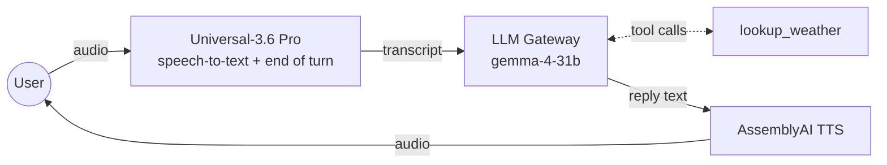

# AssemblyAI voice agent starter for LiveKit

A voice agent built with [LiveKit Agents](https://github.com/livekit/agents) where every model is from AssemblyAI, called with one API key:

| | AssemblyAI service | What it does in the agent |
|---|---|---|
| **Ears** | [Universal-3.6 Pro streaming speech-to-text](https://www.assemblyai.com/docs/voice-agents/livekit-universal-3-6-pro) | Transcribes the user and decides when they've finished their turn |
| **Brain** | [LLM Gateway](https://www.assemblyai.com/docs/llm-gateway/quickstart) | Writes the replies and calls tools, with your choice of model from Google, OpenAI, Anthropic and others |
| **Voice** | [Streaming text-to-speech](https://www.assemblyai.com/docs/tts/getting-started/quickstart) | Speaks the replies, with word timings so interruptions are recorded accurately |



It's a small, complete starting point: one agent, one example tool, tests, and a Dockerfile for deploying to [LiveKit Cloud](https://cloud.livekit.io). Fork it and make it yours.

> [!NOTE]
> The AssemblyAI TTS plugin for LiveKit is in a pull request that hasn't been released yet, [livekit/agents#8040](https://github.com/livekit/agents/pull/8040). Until it is, `pyproject.toml` installs LiveKit Agents and its plugins from [the branch that adds it](https://github.com/dlange-aai/agents/tree/feat/assemblyai-tts). Once it's on PyPI, delete the `[tool.uv.sources]` table and run `uv lock`.

## Quickstart

You need [uv](https://docs.astral.sh/uv/getting-started/installation/), [Git LFS](https://git-lfs.com) (for the voice activity model while the plugin is installed from GitHub), and an [AssemblyAI API key](https://www.assemblyai.com/dashboard/api-keys).

```console
git clone https://github.com/AssemblyAI-Solutions/assemblyai-livekit-reference-voice-agent.git
cd assemblyai-livekit-reference-voice-agent
uv sync
cp .env.example .env.local
```

Put your AssemblyAI API key in `.env.local`, then talk to the agent in your terminal:

```console
uv run src/agent.py console
```

Console mode uses your computer's microphone and speakers, and needs only the AssemblyAI key. Add `--text` to type instead of talk. Use headphones, so the agent doesn't hear itself. (With [LiveKit CLI](https://docs.livekit.io/intro/basics/cli/) 2.18.8 or later, `lk agent console` does the same.)

## Run it with LiveKit Cloud

To talk to the agent from a browser or a phone, connect it to LiveKit. Create a free [LiveKit Cloud](https://cloud.livekit.io) project and add its URL and keys to `.env.local`. If you have the [LiveKit CLI](https://docs.livekit.io/intro/basics/cli/), it can write them for you:

```console
lk cloud auth
lk app env --write --destination .env.local
```

Then start the agent in development mode:

```console
uv run src/agent.py dev
```

Open your project's [Agent Console](https://docs.livekit.io/testing/agent-console/) in LiveKit Cloud to talk to it, or connect a frontend such as [agent-starter-react](https://github.com/livekit-examples/agent-starter-react) (web), [agent-starter-swift](https://github.com/livekit-examples/agent-starter-swift) (iOS and macOS) or [agent-starter-android](https://github.com/livekit-examples/agent-starter-android). To take phone calls, see [LiveKit telephony](https://docs.livekit.io/telephony/).

With LiveKit credentials set, the agent also gets LiveKit Cloud's [adaptive interruption handling](https://docs.livekit.io/agents/logic/turns/adaptive-interruption-handling/), which tells a real interruption from an "uh-huh" in the background. Without them, it logs a warning and falls back to interrupting on voice activity.

## How it works

All of the agent is in [`src/agent.py`](src/agent.py), which is short enough to read top to bottom. These are the choices it makes, and why.

**Universal-3.6 Pro decides when the user is done.** `turn_detection="stt"` uses AssemblyAI's end-of-turn detection, which reads the transcript (a finished sentence, a question) as well as the silence. `endpointing={"min_delay": 0}` stops LiveKit from adding its own wait on top. `mode="min_latency"` ends turns soonest; switch to `"balanced"` if your users pause mid-thought and get cut off.

**The STT knows what the agent just said.** The plugin passes each of the agent's replies to Universal-3.6 Pro as context, so the model knows which question the user is answering ("which date?" then "the twelfth"). That's on by default and needs no code.

**Silero and AssemblyAI agree on what speech is.** Silero's voice activity detection decides when the user is interrupting the agent. Its threshold is set to the STT's own (`0.2`), so the two don't disagree about quiet speech.

**The LLM Gateway is used through the OpenAI plugin.** The Gateway speaks the OpenAI Chat Completions API, so `openai.LLM(base_url="https://llm-gateway.assemblyai.com/v1", api_key=ASSEMBLYAI_API_KEY)` is all it takes, with streaming and tool calls for every model family.

**The greeting doesn't wait for the LLM.** `session.say()` speaks a fixed greeting as soon as the user joins, on a TTS connection that `tts.prewarm()` opened in advance.

**Interruptions are recorded word by word.** With `use_tts_aligned_transcript=True`, AssemblyAI TTS's word timings mean that when the user cuts the agent off, the chat history keeps only the words they actually heard, so the LLM doesn't think it said things it didn't.

## Make it yours

### Instructions, greeting and tools

Edit `INSTRUCTIONS` and `GREETING` in `src/agent.py`. To give the agent a new ability, add a method decorated with `@function_tool` to `Assistant`. The docstring and type hints tell the LLM what the tool does and what to pass it. [`lookup_weather`](src/agent.py) (backed by [`src/weather.py`](src/weather.py)) is an example that calls a real API. See [LiveKit's tool docs](https://docs.livekit.io/agents/logic/tools/) for more.

### LLM

Set `LLM_MODEL` to any model on the [LLM Gateway](https://www.assemblyai.com/docs/llm-gateway/available-models) (`GET https://llm-gateway.assemblyai.com/v1/models` lists them). For a voice agent, time to the first token matters most, because the agent can't start speaking until the LLM does. Here's how a few models compared in one test, streaming a reply with a tool attached, measured from the US East Coast in October 2026:

| Model | Median time to first token |
|---|---|
| `gemma-4-31b` (default) | ~0.6 s |
| `gemini-3.5-flash-lite` | ~0.7 s |
| `claude-haiku-4-5-20251001` | ~0.8 s |
| `gpt-4.1` | ~0.8 s |
| `claude-haiku-5-5` | ~1.0 s |
| `gemini-3.6-flash` | ~2.2 s |

Measure with your own prompt and tools before you choose. Larger models give better answers more slowly, and reasoning models can take several seconds before their first word.

### Voice

Set `TTS_VOICE` to a voice id from the [AssemblyAI voice library](https://www.assemblyai.com/docs/tts/voices) or to a voice you've cloned. To speak another language, pass it to the TTS, for example `assemblyai.TTS(voice=..., language="es")`, and choose a voice for that language.

### Speech recognition

Universal-3.6 Pro does well out of the box. When it gets your domain's vocabulary wrong, add one or both of these to `assemblyai.STT(...)`:

- `keyterms_prompt=["AssemblyAI", "Universal-3.6 Pro"]`: names, brands and jargon to always get right (up to 100 terms).
- `prompt="Customer support call for a dental clinic."`: a sentence describing the conversation.

The STT recognizes many languages and switches between them on its own. To expect particular ones, pass `language_codes=["es"]` or `language_codes=["en", "es"]`. See [the Universal-3.6 Pro guide for LiveKit](https://www.assemblyai.com/docs/voice-agents/livekit-universal-3-6-pro) for every setting, including noise suppression with `voice_focus`.

### Keeping data in the EU

Point all three services at AssemblyAI's EU hosts:

```python
assemblyai.STT(..., base_url="wss://streaming.eu.assemblyai.com")
assemblyai.TTS(..., base_url="wss://tts.eu.assemblyai.com")
LLM_GATEWAY_URL = "https://llm-gateway.eu.assemblyai.com/v1"
```

The EU LLM Gateway serves Anthropic and Google Gemini models but not `gemma-4-31b`, so also switch `LLM_MODEL`, for example to `gemini-3.5-flash-lite`. Cloned voices are only available in the region where you created them.

## Tests

[`tests/test_agent.py`](tests/test_agent.py) has text-only tests of the agent's behavior: it greets the user, keeps replies speakable, uses the weather tool (mocked), and doesn't make up what it doesn't know. A second LLM on the Gateway judges each reply. They need only `ASSEMBLYAI_API_KEY`:

```console
uv run pytest
```

Run them after you change the instructions or tools, and add your own as the agent grows. See [LiveKit's testing docs](https://docs.livekit.io/testing/unit-tests/) for what they can check. GitHub Actions runs them on every push when the repository has an `ASSEMBLYAI_API_KEY` secret, and skips them otherwise.

## Deploy

The [`Dockerfile`](Dockerfile) builds a production image that runs `src/agent.py start`. It installs from `uv.lock`, so run `uv sync` once to create the lockfile, and commit it.

To deploy to LiveKit Cloud with the [LiveKit CLI](https://docs.livekit.io/intro/basics/cli/):

```console
lk agent create --secrets ASSEMBLYAI_API_KEY=<your key>
```

That builds the image, uploads it and starts the agent, and writes a `livekit.toml` for later deploys with `lk agent deploy`. See [Deploying to LiveKit Cloud](https://docs.livekit.io/deploy/agents/) for logs, scaling and secrets. The image also runs anywhere else that can run a container, given the `LIVEKIT_*` and `ASSEMBLYAI_API_KEY` environment variables.

## Project layout

```
src/agent.py        the agent: instructions, tools and the STT → LLM → TTS pipeline
src/weather.py      the current weather from Open-Meteo, for the example tool
tests/test_agent.py LLM-judged tests of the agent's replies
.env.example        the environment variables, copied to .env.local
Dockerfile          production image for LiveKit Cloud or any container host
```

## Resources

- [Universal-3.6 Pro with LiveKit](https://www.assemblyai.com/docs/voice-agents/livekit-universal-3-6-pro): turn detection, latency and accuracy tuning
- [LLM Gateway](https://www.assemblyai.com/docs/llm-gateway/quickstart): models, tool calling and prompt caching
- [AssemblyAI text-to-speech](https://www.assemblyai.com/docs/tts/getting-started/quickstart): voices, languages and voice cloning
- [LiveKit Agents docs](https://docs.livekit.io/agents/): sessions, tools, workflows and telephony

## License

[MIT](LICENSE)
